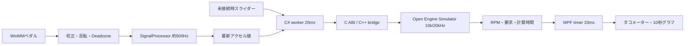

# Steering Trainer — アプリ全体・技術仕様・AI相談用引き継ぎ資料

作成日: 2026-10-11（日本時間）  
更新日: 2026-10-29（日本時間）  
対象: このフォルダにある現在の実装。過去の要求仕様と現状が異なる場合は、現状を優先して記載する。  
目的: このファイル単体を別のAIに渡し、機能改善、障害調査、設定、設計相談の前提を共有する。

**追記（2026-11-04 アクセル波形追従 メトロノーム音響機能）:**
- アクセル波形追従（ThrottleTracking）に、目標Sin波の上下ピーク（最大アクセル値・最小アクセル値）到達時に同期して鳴るメトロノーム機能を追加。
- 上ピーク（ThrottleMax到達時）は 1760 Hz (A6, 25ms, クリスタルクリック音)、下ピーク（ThrottleMin到達時）は 1175 Hz (D6, 25ms, 中音クリック音）を非同期再生。
- 左上操作カードに「メトロノーム音 (上下ピーク音)」チェックボックスおよび音量スライダーを新設。セッション中もリアルタイムに切り替え可能。
- `AppSettings` / `settings.json` に設定を永続化（`TrackingEnableMetronome`, `TrackingMetronomeVolumePercent`）。

**追記（2026-11-04 ペダル詳細校正・ガンマ設定・早期100%到達防止機能）:**
- ブレーキペダルが「100%踏み切っていないのに画面表示が100%になってしまう」問題およびGTFP等でペダルが硬く電気的限界まで踏み込めない問題に対処。
- ペダル校正モデル（`PedalConfig`）を刷新:
  - `Raw0Percent` (未踏み0%のRaw値) および `Raw100Percent` (最大踏み込み100%のRaw値) を新設。
  - ワンクリック校正ボタン「未踏み(0%)に設定」「全踏み(100%)に設定」をSETTINGS画面に配置。ペダルから足を離した状態、力いっぱい踏み込んだ状態で押すだけで瞬時にキャリブレーション可能。
  - ガンマカーブ調整（0.5〜3.0、0.1刻み、初期値1.0）を追加。ガンマ > 1.0（推奨1.5〜2.2）に設定することで、踏み始め〜中盤が緩やかになり、奥で強く踏み込むことで100%に達する実車のようなプログレッシブ特性（早期100%到達の防止）を実現。
  - 踏み切り遊び・上端デッドゾーン（`MaxDeadzonePercent` 0〜30%）を新設。ペダル限界手前で確実に100%に到達させ、奥での微小な踏み込み不足による100%抜けを防止。
  - 旧 `settings.json`（MinRaw, MaxRaw, Invert）との完全な双方向下位互換を維持。

**追記（2026-11-02 アクセル波形追従トレーニング新設）:**
- 新モード「アクセル波形追従トレーニング（Throttle Waveform Tracking Training）」を追加。タブ構成を [F1] LOCK TO LOCK, [F2] HEEL & TOE, [F3] THROTTLE TRACKING, [F4] HISTORY, [F5] SETTINGS の5画面に更新。
- 一定ブレーキ圧（例: 50%, 80%）を維持したまま、目標Sin波形に合わせてアクセルを滑らかに操作する練習モード。
- OxyPlotによるリアルタイム2段グラフ（上段: アクセル目標Sin波・許容帯・実操作の未来2秒先読み表示、下段: ブレーキ一定維持波形・許容帯）。
- 総合スコア（100点満点）、波形精度（40点）、位相遅れ精度（30点、相互相関・MSE最小化探索による位相遅延秒数）、ブレーキ安定性（30点）、踏み込み／戻し精度、踏み込み／戻しブレーキ維持率の詳細分析。
- SQLite永続化（ThrottleTrackingAttempts テーブル）および HISTORY 画面での一覧表示。
- 設定（目標ブレーキ、許容幅、アクセルMin/Max、波形速度BPM［上のピークをワンビートとして計算、4〜200 BPM／周期15.0秒〜0.30秒まで余裕を持った高速拡張］、練習時間）の自動保存・復元（settings.json）。

**追記（2026-11-02 ヒール＆トゥ目標範囲制限）:**
ヒール＆トゥ練習モードにおいて、ブレーキ量・アクセル量の目標値ランダム出題時に、出現する目標割合を制限する機能（合計4本の調整バー：ブレーキ最低値・最高値、アクセル最低値・最高値）を追加。
指定範囲 [Min, Max] 内から5%刻みでランダム出題され、settings.json にも自動保存・復元される。

**追記（2026-10-29）:** 
ユーザー要望により「DIAGNOSTICS」「SIMULATE ENGINE」「ENGINE HEEL & TOE」を削除。アプリ全体を「LOCK TO LOCK」「HEEL & TOE」「HISTORY」「SETTINGS」の4画面構成へ整理した。
また、設定永続化（`%LOCALAPPDATA%\SteeringTrainer\settings.json`）を導入し、選択デバイス（Input Device）やペダル校正値、総舵角等をアプリ終了後も保持するようにした。
さらに、アプリが非アクティブ状態であってもハンコン入力（ステアリング・ペダル・ボタン）を確実に受け付けるよう、`DispatcherPriority.Render` の適用、`SampleProduced` イベント駆動による評価処理、およびハンコンボタンによる開始/停止トグルを実装した。SETTINGS画面内にライブRaw軸モニターを追加したため、DIAGNOSTICS画面なしでペダル校正が可能。

## 目次

1. [概要と開発方針](#1-概要と開発方針)
2. [画面と操作](#2-画面と操作)
3. [技術構成とファイル](#3-技術構成とファイル)
4. [デバイス入力と信号処理](#4-デバイス入力と信号処理)
5. [Lock to Lock](#5-lock-to-lock)
6. [ヒール＆トゥ](#6-ヒールトゥ)
7. [ブレーキ保持テスト](#7-ブレーキ保持テスト)
8. [結果・平均点・永続化](#8-結果平均点永続化)
9. [効果音](#9-効果音)
10. [Simulate Engine](#10-simulate-engine)
11. [ネイティブ接続・計算ループ](#11-ネイティブ接続計算ループ)
12. [HR15DEモデル](#12-hr15deモデル)
13. [新しいエンジンモデルの追加](#13-新しいエンジンモデルの追加)
14. [ビルド・起動・配布](#14-ビルド起動配布)
15. [ログと障害調査](#15-ログと障害調査)
16. [検証済み範囲](#16-検証済み範囲)
17. [制約・改善候補](#17-制約改善候補)
18. [別のAIへの相談方法](#18-別のaiへの相談方法)

## 1. 概要と開発方針

Windows用のWPFデスクトップアプリ。ハンコンのステアリングとペダルを読み取り、操作波形を表示して練習を支援する。

主要用途は次の3つ。

- ステアリングを一定の角速度で動かす練習（Lock to Lock）。
- ブレーキを保ちながらアクセルを短く踏むヒール＆トゥ／ブリッピング練習。
- エンジンシミュレーターにアクセル入力を与え、空ぶかしの回転応答を確認する独立画面。

実機の想定はLogicool / Logitech Driving Force Pro（GTFP）。ただし接続APIが公開する軸の配置はドライバーによって異なるため、他の機器も含め設定・校正が必要。

### 現在の重要な設計判断

- エンジン計算は自作の簡易トルク式から、Open Engine SimulatorのC++コアに置き換え済み。
- エンジンは独立した「Simulate Engine」で使用する。既存のヒール＆トゥ採点にRPMやギア比を組み込んでいない。
- 標準エンジンはHonda VTEC直4。Toyota 2JZ直6、GM LS V8、推定HR15DE直4も選択できる。
- HR15DEはユーザー提供仕様と仮定を基に作ったモデル。実測車両の忠実な再現を保証するものではない。
- 通常練習に仮想ペダルUIはない。Simulate Engineに限り、実ペダルを使用できない場合の入力スライダーがある。
- 実ペダル入力・信号処理・描画・エンジン計算は分離している。

ユーザーの関心は、実機で簡単に練習できること、二重カウントしないこと、苦手な目標量を可視化すること、起動の簡便さ、エンジンの過渡回転応答にある。

## 2. 画面と操作

| タブ順・内部Index | 表示 | 役割 |
| --- | --- | --- |
| 0 | [F1] LOCK TO LOCK | 角度・角速度・加速度、目標速度への判定、CSV出力 |
| 1 | [F2] HEEL & TOE | 練習、設定、結果マップ、ブレーキ保持テスト |
| 2 | [F3] THROTTLE TRACKING | アクセル波形追従（目標Sin波・先読み表示・位相遅れ評価・詳細分析） |
| 3 | [F4] HISTORY | 過去の練習履歴（アクセル波形追従 & ヒール＆トゥ）のSQLite一覧表示 |
| 4 | [F5] SETTINGS | デバイス選択、Live Raw軸モニター、総舵角、ペダル校正、フィルター |

### キーボード

- F1〜F4: 対応画面に移動。
- F5: Simulate Engineに移動（タブ見出し自体にはF5表記がない）。
- Space: Lock to Lockの開始／停止。
- Escape: Lock to Lockを停止。
- TextBoxでの入力中はショートカット処理を抑止。

F6はエンジン回転合わせ画面へ移動する。Space / Escapeは現在のタブにかかわらずLock to Lock側の操作であり、ヒール＆トゥやエンジンの一括停止ではない。

### 共通UI

ダークテーマ、接続状態、デバイス名、実測サンプリングHz、ステータスを表示する。設定画面のComboBox項目は、展開時にも読める文字色に変更済み。

## 3. 技術構成とファイル

### 言語・実行基盤

| 部分 | 技術 |
| --- | --- |
| UI | C#、WPF、XAML、MVVM |
| 管理コード | .NET 8、net8.0-windows、Nullable / ImplicitUsings有効 |
| グラフ | OxyPlot.Wpf 2.1.2 |
| DB | Microsoft.Data.Sqlite 8.0.0 |
| 効果音 | System.Windows.Extensions 8.0.0、System.Media.SoundPlayer |
| ハンコン | winmm.dllへのP/Invoke |
| エンジン | C++17、Open Engine Simulator、C ABIラッパー |
| nativeビルド | CMake、MSVC、WinFlexBison |
| 起動 | bat → PowerShell → dotnet + App.dll |
| 管理コードテスト | xUnit 2.6.1、FluentAssertions 6.12.0、Test SDK 17.8.0 |

SharpDX関連のPackageReferenceはコメントアウトされており、現在の入力取得に使用していない。

### プロジェクト分割

```text
SteeringTrainer/
├─ SteeringTrainer.sln
├─ 起動する.bat / Launch.ps1
├─ README.md
├─ ENGINE_MODEL_NOTES.md          エンジン定義の作成・接続メモ
├─ HR15DE_MODEL.md                HR15DE仮定・調整・測定結果
├─ APP_TECHNICAL_HANDOFF.md        この資料
├─ SteeringTrainer.App/           WPF・画面・ViewModel
│  ├─ App.xaml(.cs) / AppLog.cs
│  ├─ MainWindow.xaml(.cs)
│  ├─ Controls/TachometerControl.cs
│  ├─ ViewModels/                 各画面の状態、RelayCommand、ViewModelBase
│  └─ Views/                      各画面のXAML
├─ SteeringTrainer.Core/          入力・信号・練習の計算
│  ├─ Devices/                    WinMM実機、Synthetic、DeviceManager
│  ├─ Models/                     サンプル、校正、練習設定等
│  ├─ Signal/                     SignalProcessor、EMA
│  ├─ Collections/RingBuffer.cs
│  └─ Training/HeelToe/           状態機械、採点、保持テスト、効果音
├─ SteeringTrainer.Infrastructure/
│  └─ Persistence/               結果SQLiteと記録型
├─ SteeringTrainer.Tests/         CoreTests.cs
└─ native/
   ├─ CMakeLists.txt / BuildNative.ps1
   ├─ SteeringTrainerEngineBridge.h(.cpp)
   ├─ engine_bridge_smoke.cpp
   ├─ hr15de_calibration.py
   ├─ OPEN_ENGINE_SIM_PIN.md
   ├─ EngineModels/hr15de.mr      自作定義をvendor外で管理
   ├─ open-engine-sim/            固定コミットの依存ソース・assets
   └─ build-tools/                WinFlexBisonとライセンス
```

App → Core / Infrastructure、Infrastructure → Coreの参照構造。native P/Invokeと共通workerはApp/Services/EngineSimulationService.csにある。独立したmanagedラッパープロジェクトにはまだ分けていない。

### 主要クラスの責務

| クラス | 責務 |
| --- | --- |
| MainViewModel | 子VM生成、デバイス自動選択、SignalProcessorの接続、タブ切替 |
| SettingsViewModel | デバイス列挙・適用、舵角・入力設定 |
| TrainingViewModel | Lock to Lock、速度判定、加速度グラフ、CSV |
| DiagnosticsViewModel | 入力診断用バッファと3種類のグラフ |
| HeelToeViewModel | 練習操作、状態表示、結果表示、平均、保存と集計 |
| HeelToeTrainingEngine | サンプルからブリップの開始・終了・採点を判定 |
| BrakeStabilityAnalyzer | ブレーキの抜け・増加・変動・復帰を評価 |
| ThrottleBlipAnalyzer | アクセル量・タイミング・時間を評価 |
| BrakeHoldTrainingEngine | 目標ブレーキの連続保持までの時間を計測 |
| HeelToeHistoryRepository | SQLite初期化、保存、読み込み、簡易移行 |
| SimulateEngineViewModel | engine生成、入力選択、worker、描画、設定保存 |
| TachometerControl | WPFでタコメーターを描画 |
| AppLog | アプリ単位の起動・例外ログ |

## 4. デバイス入力と信号処理

### 入力APIと選択

`DirectInputSteeringDevice`というクラス名だが、実装はDirectInput COM APIではなくWindows Multimedia API（WinMM）。使用関数はjoyGetNumDevs、joyGetDevCaps、joyGetPosEx。

- デバイスID: `winmm_0`等。
- 軸: X / Y / Z / R / U / V、未割当None。
- ステアリングはX固定。デバイス能力のX最小・最大値で -1〜+1 に正規化。
- 起動時、列挙された最初の非Syntheticデバイスを優先する。なければSyntheticを選択。
- デバイス側の背景スレッドはjoyGetPosExを繰り返し、Thread.Sleep(1)する。正確な500Hz保証ではない。
- 別のSignalProcessorスレッドが目標500Hzで最新値を読む。デバイスの更新頻度とアプリのサンプリング頻度は別。
- 接続失敗時はIsConnectedをfalseにする。デバイス側に残った前回値がただちにすべてゼロ化される設計ではない。

SyntheticSteeringDeviceは実機なしのステアリング診断用。Simulate Engineでは実ペダル接続として扱わない。

### ペダルの初期割当

| ペダル | 軸 | Raw範囲 | 反転 | 下側デッドゾーン | Gamma |
| --- | --- | --- | --- | --- | --- |
| アクセル | Z | 0〜65535 | true | 2% | 1 |
| ブレーキ | R | 0〜65535 | true | 3% | 1 |
| クラッチ | None | 0〜65535 | true | 3% | 1 |

アクセルは「踏むとZが減り、全踏みで0になる」というユーザーの観察に合わせてZ反転へ変更された。未踏みRawが65535でない場合は、初期範囲のままだと未踏み時の表示が0%にならないため、実際の端点で校正する必要がある。

### 校正の式

PedalConfig.Normalizeは次の順番。

```text
min = min(MinRaw, MaxRaw)
max = max(MinRaw, MaxRaw)
r = (clamp(raw,min,max) - min) / (max-min)
Invertなら r = 1-r
r < dz なら 0
それ以外は p = clamp((r-dz)/(1-dz),0,1)
Gammaが有効なら p = p^Gamma
```

Noneまたは範囲ゼロなら0。MinRawとMaxRawを逆に入力するだけでは反転しない。向きはInvertが決める。

SETTINGSで軸、端点、反転、デッドゾーンを手入力する。自動で踏み離し端点を採取するウィザードはない。Gammaはモデルに存在するが、通常の校正UIですべてのカーブを編集する設計ではない。

### 信号処理

- 角度: 正規化入力 × 総舵角/2 にセンター補正等を適用。
- 総舵角初期値900°、選択肢200 / 360 / 540 / 720 / 900 / 1080。
- 角度にEMA、その差分/dtから角速度、その角速度にEMA、差分/dtから角加速度。
- ペダルはアクセル・ブレーキに係数0.02のEMA、クラッチはそのまま。
- SteeringSampleはtimestamp、Raw / filtered角度、速度、加速度、Raw / filteredペダル、6本のRaw軸を保持する。
- 時間はStopwatchの単調増加ticksとFrequencyで算出する。
- LatestSample、SampleProducedイベント、内部ConcurrentQueueの3経路がある。

EMAの係数の意味は一般的な「新値への重み」と逆なので注意。

```text
y[k] = alpha * y[k-1] + (1-alpha) * input[k]
alpha=0: フィルターなし
alphaが大きいほど強く平滑化
```

EmaFilter.Filter(value,dt)は現在dtを使用していない。サンプリング頻度が変わると時間単位の応答も変わる。角度初期alpha=0.1、角速度0.05。FilterStrengthを変更すると速度側はその半分になる。

SignalProcessorの500Hz待機はSpinWaitであり、CPUを使う。表示Hzは1秒程度ごとの実測値で、機器のUSB転送Hzを測っているわけではない。

## 5. Lock to Lock

目標角速度に対して現在の絶対角速度を比較する。画面名は以前のTrainingからLOCK TO LOCKへ変更済み。

| プリセット | LockAngle | TimeSide | TargetVelocity |
| --- | --- | --- | --- |
| Beginner | 540° | 3.0秒 | 180°/s |
| Normal | 540° | 2.5秒 | 216°/s |
| Fast | 540° | 2.0秒 | 270°/s |
| Advanced | 720° | 2.5秒 | 288°/s |

```text
目標速度 = LockAngle / TimeSideSeconds
誤差[%] = abs(abs(現在速度)-目標速度) / 目標速度 * 100
誤差 < 5: GOOD
誤差 < 15: WARNING
それ以外: MISS
```

開始でセッションバッファをクリアして記録、停止で判定を解除する。現状は角速度のリアルタイム比較が中心であり、左右ロック到達を自動認識して往復全体を採点する完成した状態機械ではない。TrainingPhase / TrainingSession等の型があることと、画面でその全仕様が動いていることは区別する。

角加速度グラフは直近8秒、表示専用EMA alpha=0.72で平滑化する。数値表示のCurrentAcceleration自体はこの追加フィルター前の値。グラフの平滑化は採点に適用していない。

セッションの記録はUIタイマーが最新サンプルを取り込む方式で、500Hz全点記録ではない。バッファ容量は150,000サンプル（コードのコメントは500Hz×5分）。実際はUI周期で記録するため、保持時間はそのコメントの5分とは一致しない。

CSVはWindowsのMyDocumentsへ`SteeringTrainer_yyyyMMdd_HHmmss.csv`としてUTF-8出力。

```csv
timestamp_s,raw_angle,filtered_angle,velocity,acceleration,raw_normalized
```

timestamp_sはStopwatch由来。ペダル列、RPM列、セッション総合点は含まれない。数値書式は現状のカルチャーに依存するため、別ロケールで小数点・CSV区切りの扱いを確認する余地がある。

## 6. ヒール＆トゥ

### 練習の種類

- 10回チャレンジ: 5試行ごとに目標ブレーキ・アクセルの組を変更する。
- フリー練習: 自分で目標を設定。ブレーキ／アクセルのランダムを別々に選べる。
- ブレーキ安定テスト: 別エンジンで0.5秒保持を計測する。

設定はExpanderで見え隠れする。目標ブレーキ5〜95%、目標アクセル5〜100%、いずれも5%刻み。ブレーキ許容幅1〜15%、アクセル許容幅5〜30%（5%刻み）。難易度変更は設定値をプリセットへ戻す。

| 値 | Beginner | Normal | Advanced |
| --- | --- | --- | --- |
| 初期目標ブレーキ | 50% | 50% | 50% |
| ブレーキ許容 | ±5% | ±3% | ±2% |
| 初期目標アクセル | 30% | 30% | 30% |
| アクセル許容 | ±10% | ±7% | ±5% |
| 目標ブリップ時間 | 250ms | 200ms | 180ms |
| 安定待ち | 200ms | 250ms | 300ms |
| 理想反応時間 | 100〜500ms | 120〜400ms | 150〜300ms |
| 早すぎる閾値 | 40ms | 60ms | 80ms |
| 遅すぎる閾値 | 1000ms | 700ms | 500ms |

共通初期値: BrakeEntryThreshold=10%、BlipTimeoutMs=1800、BrakeRecoveryTimeMs=200、ChallengeRounds=10。手本波形表示とブラインドモードもある。

### 1回の判定・状態遷移

```text
Idle
  → BrakeEntry（ブレーキ10%以上）
  → BrakeStabilizing（目標許容範囲を連続して維持）
  → BrakeStabilized（音・BLIP合図）
  → ThrottleBlipping（アクセル5%以上）
  → BrakeRecovery（アクセルが max(3%,ピークの15%) 以下へ戻る）
  → AttemptFinished（復帰待ち後に採点・記録）
  → アクセル3%以下を確認して次試行を許可
  → Idle
```

ブレーキを毎回ゼロへ戻す必要はない。アクセルの戻りを次のブリップの基準にする。安定前にアクセル5%以上ならEarlyBlipとして0点、合図後タイムアウトはLateBlipとして0点。10回到達でChallengeCompletedとなる。

過去に1回のブリップが何回も数えられる問題があった。現状はProcessSampleをlockで直列化し、非増加timestampを拒否し、イベント発行より前に完了ラッチとAttemptFinishedを設定する。今後変更する際にこの順番を崩さないこと。

5回のブロックには成功だけでなく採点された失敗試行も含む。ランダム候補はブレーキ5〜95%、アクセル5〜100%。両方をランダムにするとき、前回と同一の組になった場合はアクセルを1段ずらす。片側だけのランダムでは同じ値が再選択される可能性がある。

### 採点: 100点満点

| 内訳 | 最大 |
| --- | --- |
| ブレーキ安定 | 50 |
| ブリップ量 | 20 |
| 反応タイミング | 20 |
| ブリップ時間・キレ | 10 |

ブレーキ安定は50点から次を減点して0〜50へ制限。許容幅を`t`、目標を`B`とする。

- 抜け: `B - 最小値 > t`なら、超過分eに対しmin(40,15+5e)点。
- 踏み増し: `最大値 - B > t`なら、min(30,10+4e)点。
- 変動幅が1.5t超かつBrakeDropがない場合、min(15,(変動幅-t)*3)点。
- ブリップ後の復帰値が許容幅を超える場合、min(10,(絶対誤差-t)*2)点。

ブリップ量は不足超過1%あたり2点、踏みすぎ超過1%あたり1.5点。許容内でも誤差比に応じ最大2点の微減点。ピーク5%未満はNoBlipで量0点。

タイミングは理想範囲内20点、早すぎ・遅すぎ閾値内で理想範囲外なら18点。早すぎは閾値までの差×0.3、遅すぎは閾値からの差×0.04を20点から減点して下限0。

時間評価は350ms超でLongBlip、超過ms×0.05を10点から減点。80ms未満は7点。その他は目標時間との誤差50ms以内で10点、それを超えると減点し最低5点。これは波形の数学的なジャーク評価ではなく、主に持続時間の評価。

| 総合判定 | 条件 |
| --- | --- |
| PERFECT BLIP! | 92点以上かつ失敗理由なし |
| GOOD | 80点以上 |
| OK | 60点以上 |
| MISS | その他 |

結果オブジェクトはブレーキ前後値・最小最大・アクセルピーク・反応時間・継続時間・内訳・失敗理由・試行サンプルを持つ。ただしこのすべてがDBへ永続化されるわけではない。

## 7. ブレーキ保持テスト

ブレーキ10%以上に入った時点から計時し、目標±許容幅に連続0.5秒入るまでの経過時間を測る。範囲を外れると保持開始時刻をリセットする。

表示の経過時間には0.5秒の保持時間も含まれる。純粋な「範囲に到達するまでの時間」だけではない。

成功後はブレーキ10%未満へ戻すと次試行へ進む。このモードはブリッピングと異なり、アクセル解放では再開しない。

同じ目標で5回成功したら、次の目標ブレーキを5%刻みでランダムに変更する。テストボタンをもう一度押すとフリーのブリッピング練習へ戻る。

保存スコアは次の簡易式。

```text
Score = clamp(100 - ElapsedSeconds * 10, 0, 100)
```

最短でも保持時間を含むため、現在の式では通常100点にはならない。失敗途中のタイムアウト記録ではなく、完了した試行を保存する。

## 8. 結果・平均点・永続化

### 3種類の集計を混同しない

1. **ブレーキを離すまでの連続平均**: 今回の連続ブリップの平均と回数。ブレーキ0判定で消える。保存しない。
2. **練習中の目標ブレーキ別平均・チャレンジ集計**: 現在の試行結果から表示する集計。
3. **結果マップ**: SQLiteに蓄積した過去の記録を読み込む。

連続平均のゼロ判定はfiltered Brake <= 0.005、つまり0.5%以下。ノイズ対策のため厳密な浮動小数点ゼロではない。ブレーキを維持していれば目標切替をまたいで平均を表示し、0点の試行も平均に含む。ブレーキ保持テストの成績はこの平均に混ぜない。

### 結果マップ

- 通常チャレンジとフリーを別マップにする。
- 横軸目標ブレーキ5〜95%、縦軸目標アクセル5〜100%。
- 19×20条件を5%単位のセルへ集計し、平均スコアを色にする。
- 低得点は赤、高得点は緑。未記録セルと0点を区別する。
- 軸のスクロールズーム・パンは無効。
- 記録回数、条件数、最も平均の低い条件も文字で表示する。
- ブレーキ保持結果は別グラフで横軸目標ブレーキ、縦軸スコア。

難易度や許容幅、入力校正が違っても同じ目標セルへ集計される。現在のDBにはそれらの設定を保存していないため、条件が変わった記録の厳密比較には限界がある。

### 保存場所

| 内容 | 場所 |
| --- | --- |
| 練習結果 | `%LOCALAPPDATA%\SteeringTrainer\training-history.db` |
| エンジン選択と調整 | `%LOCALAPPDATA%\SteeringTrainer\engine-sim-settings.json` |
| 起動・例外ログ | `%LOCALAPPDATA%\SteeringTrainer\logs\` |
| Lock to Lock CSV | Windows MyDocuments |
| nativeビルド | `%USERPROFILE%\SteeringTrainerNativeBuild\` |
| nativeソースjunction | `%LOCALAPPDATA%\SteeringTrainer\NativeSource` |
| 実行時生成エンジン定義 | `%TEMP%\SteeringTrainerEngineSim\` |

### SQLiteスキーマ

```sql
HeelToeAttempts (
  Id INTEGER PRIMARY KEY AUTOINCREMENT,
  RecordedAtUtc TEXT NOT NULL,
  TargetBrake REAL NOT NULL,
  TargetThrottle REAL NOT NULL,
  Score REAL NOT NULL,
  BrakeStabilityScore REAL NOT NULL,
  TimingScore REAL NOT NULL,
  AmountScore REAL NOT NULL,
  Grade TEXT NOT NULL,
  IsChallenge INTEGER NOT NULL DEFAULT 1
)
BrakeHoldAttempts (
  Id INTEGER PRIMARY KEY AUTOINCREMENT,
  RecordedAtUtc TEXT NOT NULL,
  TargetBrake REAL NOT NULL,
  ElapsedSeconds REAL NOT NULL,
  Score REAL NOT NULL
)
```

UTC時刻をISO形式で保存する。古いDBにIsChallenge列がない場合はALTER TABLEで追加し、既存記録は通常チャレンジ扱いになる。

保存はTask.Runで非同期実行し、完了後UIへ反映する。各操作で接続を開き、パラメーター付きSQLを使う。現状は全記録読み込みで、ページング・大量記録向け集約DB・削除UI・完全な試行波形保存・CSV一括出力を備えていない。

通常SETTINGSのデバイス校正や舵角、ヒール＆トゥ設定には現在JSON等への保存処理がない。再起動時に復元されるエンジン設定と混同しない。

## 9. 効果音

HeelToeAudioServiceがメモリ上で16bitモノラル22,050HzのPCM WAVを作り、SoundPlayer.PlaySyncをTask.Run内で実行する。開始・終了を短くフェードする。Volumeは0〜1、初期0.5。UIは音量と試聴に対応。

| 通知 | 音 |
| --- | --- |
| BrakeStable | 880Hz / 80ms |
| BlipPrompt | 1200Hz / 100ms |
| Perfect | 1400Hz / 100ms → 1760Hz / 160ms |
| Good | 1046Hz / 120ms |
| Miss | 330Hz / 220ms |

音の例外は捕捉して無視するため、音が鳴らないことがログに残らない場合がある。複数通知は独立Taskで、専用の音キューやミキサーによる重なり制御はない。

この効果音とエンジン音は別機能。**現在のSimulate Engineはエンジン音をスピーカーへ再生しない。**

## 10. Simulate Engine

### 表示と設定

- タコメーター、RPM数値、ペダル入力バー、有効スロットル要求バー、rpm/s。
- 直近約10秒のRPMとアクセル入力の時系列グラフ。
- モデル名、内部計算Hz、更新処理の所要ms等。
- エンジン選択、慣性倍率、摩擦倍率、ペダル指数、開き／閉じの応答遅れ。
- 「適用」「標準に戻す」「回転数リセット」。HR15DEには軽量フライホイール設定ボタン。
- 実ペダル使用不能時に0〜100%手動スライダー。

手動スライダーは実デバイス接続中に併用できない。接続中でもアクセルの軸校正が間違っている場合、接続判定だけではその誤りを見抜けない。

### エンジン一覧

| ID | 選択名 | 定義のassets相対パス | node | 内部Hz | 表示レッドライン / 点火制限 |
| --- | --- | --- | --- | --- | --- |
| 0・標準 | Honda B18C5 VTEC I4 | engines/atg-video-1/05_honda_vtec.mr | honda_vtec_i4 | 20,000 | 8,400 / 9,400rpm |
| 1 | Toyota 2JZ I6 | engines/atg-video-2/03_2jz.mr | t2jz | 10,000 | 6,000 / 6,500rpm |
| 2 | GM LS V8 | engines/atg-video-2/07_gm_ls.mr | ls_v8 | 10,000 | 6,500 / 6,800rpm |
| 3 | Nissan HR15DE・推定固定カムI4 | engines/steering-trainer/hr15de.mr | hr15de_i4 | 20,000 | 7,000 / 7,000rpm |

Hondaのタコメーター上限は10,000rpm、他は8,000rpm。これは初期要求の一律8,000rpmから変更されている。

### 適用と始動

- エンジン選択は直ちに再生成・自動始動する。
- 倍率・感度・遅れの編集は「適用」時に再生成する。
- 再生成中は操作を制限する。worker停止 → 新モデル生成 → 旧モデル破棄 → 設定保存 → 表示初期化 → 再開。
- 生成失敗時はエラーを表示し、利用可能な旧モデルがあれば維持する。
- HR15DEを選ぶとその標準調整値へ戻して適用する。その他のモデル選択では現在の調整値が持ち越される。
- 初回入場時にモデルを生成し始動する。
- 画面を離れると計算workerを止める。**現在は再入場時に既存モデルの状態を保持して再開する。自動で毎回アイドルへリセットする仕様にはなっていない。**
- ResetはHR15DEを800rpm、その他を850rpmへ戻す。モデルを作り直す操作ではない。

### 調整範囲・初期値

| 項目 | 範囲 | Honda等の標準 | HR15DE標準 |
| --- | --- | --- | --- |
| FlywheelMultiplier | 0.5〜2.5 | 1 | 1 |
| FrictionMultiplier | 0〜2.5 | 1 | 1 |
| PedalSensitivity | 0.5〜2 | 1 | 1.5 |
| 開き応答 | 0〜300ms | 80ms | 40ms |
| 閉じ応答 | 0〜300ms | 80ms | 60ms |

JSONにはFlywheelMultiplier、FrictionMultiplier、PedalSensitivity、ResponseMilliseconds、EngineIndex、CloseResponseMillisecondsを保存する。旧形式で閉じ応答がない場合は開き応答を使用し、EngineIndexがない場合は0。読み込み失敗は無視して初期値を使う。保存は基本的に適用時。

以前の簡易モデルにあった詳細トルクテーブルUI、損失式の係数編集、アイドル／レブ値編集UIは、現在のOpen Engine Simulator画面にはない。必要なモデル詳細は.mr定義で編集する。

## 11. ネイティブ接続・計算ループ

### 採用元・固定バージョン

- 採用: https://github.com/zabayone/open-engine-sim
- 固定commit: `9abd876e8521a39ad3b423bf03a4b2325d4f8338`
- 比較元: https://github.com/carlesonielfa/open-engine-sim
- 比較時のcarlesonielfa commit: `1e226ee7bfbeb1d5012c7696aee82a57355df281`
- solver: `e009f4ff1c9c4c5874e865e893cdb62e208fb2b3`
- csv-io: `2112c55e1e831c8f7a1b91de23722b7926ad3d00`
- piranha: `432f0b122bb1663b686c553c7e7269300afac3bc`

headless統合に適した経路があるためzabayoneを採用。SDLデスクトップホストを使わずコアとスクリプト処理をビルドする。依存情報はnative/OPEN_ENGINE_SIM_PIN.mdにも保存している。上のSHAは採用時点の固定値で、現在のGitHub最新HEADを意味しない。

### データフロー



### C ABI

DLL名: `SteeringTrainer.EngineSim.dll`。C#側はCdeclのDllImport。

```c
void* steering_engine_create(
  const char* assetDirectory, int engineId,
  double flywheelMultiplier, double frictionMultiplier,
  double pedalSensitivity,
  double openResponseSeconds, double closeResponseSeconds);
int steering_engine_step(void* handle, double pedal,
                         double elapsedSeconds, Snapshot* result);
int steering_engine_reset(void* handle);
void steering_engine_destroy(void* handle);
const char* steering_engine_last_error();
int steering_engine_measure_torque(void* handle,
                                  double targetRpm, double* torqueNm);
```

Snapshotは順にdouble 5項目（rpm / pedal / effectiveThrottle / rpmPerSecond / updateMilliseconds）、int 2項目（simulationFrequency / simulationSteps）。C# StructLayout.SequentialとC++のレイアウトを一致させる。measure_torqueは診断用で、通常の空ぶかしUIでは呼ばない。

native handleはengine / vehicle / transmission / simulatorと入力フィルター状態を所有する。Step、Reset、トルク測定はmutexで保護する。破棄はworker停止後。エラー文字列はthread_localのため、失敗呼び出しと同じスレッドで読む必要がある。

### 定義ロードとパラメーター反映

1. 選択.mrを読み、設定に応じて慣性・摩擦を変更したコピーを作る。
2. `%TEMP%\SteeringTrainerEngineSim\`に生成定義とentry.mrを置く。
3. entryから生成定義をimportしmainを実行する。
4. スクリプトcompilerからengine / vehicle / transmissionを受け取りsimulatorへ渡す。
5. 元のvendor定義は書き換えない。

現在の生成ファイル名`standard_honda_vtec.mr`は他モデルでも共用する名前であり、名前だけで内容を判断しない。慣性・摩擦の置換は既知の定義構造を前提にした文字列／正規表現処理。

Hondaは合成慣性全体を倍率変更する。2JZ / V8 / HR15DEは`crank_moment + flywheel_moment * 倍率 + other_moment`のようにフライホイール部分を変える。すべてのエンジンで物理的に同じ範囲を変更しているわけではない。

### 入力応答

```text
u = clamp(校正済みペダル,0,1)
q = u^PedalSensitivity
tau = q>x ? 開き時定数 : 閉じ時定数
x = q + (x-q)*exp(-dt/tau)    # tau=0なら即時
engine.setSpeedControl(x^(1/nativeThrottleGamma))
```

最後の逆指数は、定義内部のスロットルGammaとの二重適用を避ける処理。Honda / 2JZ / V8の定義Gammaは2、HR15DEは1.5。校正側のPedalConfig.Gammaを変更すれば、そちらの加工はさらに手前で適用される。

### 3段階の周波数

- 実入力処理: 目標500Hz。
- C# worker: 固定20msのシミュレーションブロック、50Hzで最新入力を渡す。
- native内部: 定義に応じ10,000 / 20,000Hzの物理計算。
- WPF描画: DispatcherTimer 33ms、約30Hz。

最初の要求の「5ms / 200Hz簡易モデル」は現在の実装ではない。高周波の内部物理計算と、50Hzの入力供給を区別する。

native Stepはelapsedを1〜100msへ制限し、最大約20msのブロックに分け、startFrame → simulateStepの繰り返し → endFrameを行う。rpm/sは前回RPMとの差を渡された時間で割る。

C# workerはStopwatchで次の期限を管理し、余裕があればTask.Delay、4ブロック以上遅れた場合は期限を現在時刻へ戻す。描画とは分離しているが、CPU負荷が高いと壁時計に対して計算が遅れる可能性があり、任意負荷下でリアルタイムを保証しない。

nativeのオーディオ生成は内部バッファを進めるためにpumpして、読み出したサンプルを破棄する。出力サンプルレートは44,100Hz。

### 自動始動とリセット

点火ON、dynoOFF、starterON、入力ゼロで20msずつ始動計算する。最大300回＝6秒のシミュレーション時間。少なくとも約1.5秒進めてRPM>800になれば始動ループを抜け、starterOFF後に約0.5秒計算する。非有限値や400rpm未満なら生成失敗。

コアは定義のstarter_speedを反転してスターターに渡す。Hondaの定義値は負なので実始動方向は正、HR15DE等の定義値が正なら実始動方向は負になる。RPM表示は絶対値である。ブリッジは始動後の実角速度の符号を取得してResetに使用する。回転合わせのprepareはdynamometer拘束で指定RPMへ収束・保持し、releaseで拘束を無効化する。各substepのクランク速度強制上書きは行わない。準備時間は最低200ms、最大2秒のシミュレーション時間。

アプリ独自の閉ループアイドル制御は追加していない。定義のアイドル開度・内部計算でアイドル付近を作る。

## 12. HR15DEモデル

### 位置づけ

ユーザーの所有車はマーチNISMO S。実車公表仕様と推定値は別フォルダの`memory/profile/マーチニスモS/車両・エンジン情報.md`に保存済み。本章はアプリモデルに必要な情報を再掲する。

### 実車資料に基づく値

| 項目 | 値 |
| --- | --- |
| 形式 | HR15DE、直列4気筒DOHC |
| ボア × ストローク | 78.0 × 78.4mm |
| 公称排気量 | 1,498cc |
| 圧縮比 | 10.5 |
| 最高出力 | 85kW / 6,000rpm |
| 最大トルク | 156N·m / 3,600rpm |
| 純正フライホイール重量 | 7.35kg |
| NISMO軽量品重量 | 4.92kg |
| NISMO資料の慣性指標 | 純正0.847、軽量0.489、比約57.7% |

資料: [日産マーチNISMO諸元PDF](https://history.nissan.co.jp/ARCHIVES/PDF/MARCH/K13/20200716/march_nismo_specsheet.pdf)、[NISMO軽量フライホイール](https://www.nismo.co.jp/products/web_catalogue/clutch_mission/lightweight_flywheel.html)。NISMO表の慣性指標を、そのままkg·m²と見なさない。ユーザーの車に軽量品が装着済みとは確認していない。

### 仮定・モデル入力

| 項目 | モデル値 | 性質 |
| --- | --- | --- |
| アイドル目標 | 800rpm | 仮の動作点 |
| レブ制限 | 7,000rpm | 実車値未確認 |
| 点火カット継続 | 0.05秒 | 仮設定 |
| クランク合成慣性 | 0.18kg·m² | 推定 |
| クランク・カバー等 | 0.097kg·m² | 仮の内訳 |
| 純正フライホイール部分 | 0.083kg·m² | 円板近似 |
| 追加クランク摩擦 | 5N·m | 推定、内部損失と別 |
| ペダル指数 | 1.5 | 操作感の仮設定 |
| 開き / 閉じ遅れ | 0.04 / 0.06秒 | 追加応答の仮設定 |
| プレナム | 1.5L、断面20cm² | 推定 |
| 吸気 / 排気最大リフト | 8.5 / 8.0mm | 推定 |
| 1.27mm基準の作用角 | 吸気190° / 排気180° | 推定 |
| ローブ中心 | 吸気ATDC110° / 排気BTDC110° | 固定位相の近似 |
| 点火 | 800rpmで10°、2000で20°、3000以上28°BTDC | 負荷依存なし |
| コンロッド | 長さ140mm、0.40kg、0.00065kg·m² | 推定 |
| ピストン | 0.35kg、圧縮高さ28mm | 推定 |
| クランク質量 | 10kg | 推定 |
| スターター指定 | 80N·m、300rpm | 仮設定 |

内蔵スターター処理が排気量当たりの最低トルクを適用するため、実際の有効スタータートルクは指定80N·mそのままとは限らない。

### 寸法・慣性の整合

```text
デッキ高さ = 140 + 28 + 78.4/2 = 207.2mm
1気筒のすきま容積 ≈ (1498/4)/(10.5-1) = 39.4cc
標準J = 0.097 + 0.083 = 0.180kg·m²
軽量倍率 = 0.489/0.847 = 0.577331759...
軽量J = 0.097 + 0.083*軽量倍率 ≈ 0.144918536kg·m²
```

デッキ高さは仮想寸法の整合で、実車寸法ではない。燃焼室39.4ccはピストン頂面形状とデッキ隙間をゼロとする簡略モデル。ボア・ストロークからは約1.49856Lになる。

ピストン・コンロッドは内部で別に動くため、それらの慣性を上のJへ再び足さない。摩擦も旧簡易モデルの損失式をさらに足していない。

### Hondaから引き継いだもの

ポート流量のリフト曲線、燃焼・乱流の基本設定、ピストン摩擦、吸排気ランナー・音響の基本定義等を動作するHondaから引き継いだ。HR15DE実測値ではない。

Honda VTEC切替は残さず、固定カムのstandard valvetrainに置き換えた。実車HR15DEのVVTは現在再現していない。カム位相は正回転に合わせ吸気360+110、排気360-110を基準に各気筒のオフセットを加える。

### 初期案から校正で変更した値

| 項目 | 提供された初期案 | 現在の定義 |
| --- | --- | --- |
| スロットル流量 | k_carb(220) | k_carb(160) |
| アイドルスロットル位置 | 0.997 | 0.9938 |
| 最大燃焼効率 | Honda由来0.75 | 0.88 |

アイドル別系統流量はk_carb(0)。スロットル内部値は1側が閉じ側。k_carbの値は流量係数の設定であり、常にそのCFMが流れる意味ではない。

定常トルクを合わせる調整に慣性は使わず、吸気・燃焼等を調整した。

vehicleの便宜的設定に車重1010kg、最終減速比4.066、5MT比3.727 / 2.047 / 1.392 / 1.029 / 0.820がある。ただしタイヤ・空力・クラッチ等まで実車として確定した車両走行モデルではなく、画面の主用途はニュートラル空ぶかし。

## 13. 新しいエンジンモデルの追加

最低限、次の情報が必要。

1. 気筒数・配置、ボア・ストローク、圧縮比。
2. コンロッド長・質量・慣性、ピストン質量と圧縮高さ、デッキ高さ。
3. クランク、ジャーナル角度、気筒と接続するクランクピン、点火順序。
4. クランク・フライホイール・その他の慣性内訳、摩擦。
5. 吸排気カムの作用角・リフト・中心角、リフトごとのポート流量曲線。
6. 吸気プレナムと流量係数、アイドル開度、排気ランナー等。
7. 燃料、燃焼効率・燃焼速度・乱流等。
8. 点火進角曲線、レブ制限とカット時間、スターター。
9. simulation_frequency、native throttle_gamma。
10. 目標アイドル、定常トルク曲線、過渡応答の実測または仮の比較基準。

未知値は既知の動作する定義から継承し、仮定として記録する。最大流量1個だけではポート流量曲線を定義できない。定常出力と回転慣性の調整を混ぜない。

### 実装手順

- custom .mrはnative/EngineModelsに置き、元の著作権・ライセンスを保持する。
- main nodeからengine / vehicle / transmissionを返す形式に合わせる。
- bridge側にID、パス、内部Gamma、慣性置換等を登録する。回転方向は始動後の実角速度から取得する。
- C#側のEngineNames、ID範囲、表示上限、redline、設定初期値、保存互換を更新する。
- csprojのContentによりビルド出力のEngineSimAssets/engines/steering-trainerへコピーされる。
- UI接続前にnativeで生成 → 始動 → 入力 → RPM取得を確認する。
- 定常トルクはdynoの固定回転測定、過渡応答は空ぶかしで分けて評価する。
- 全既存モデルの生成・始動・調整値適用が壊れていないことを確認する。

## 14. ビルド・起動・配布

### 現在の作業場所

```text
C:\Users\raku3\OneDrive - Kyushu Institute Of Technolgy\antigravity\allinone\運転練習\SteeringTrainer
```

### 普段の起動

このフォルダの`起動する.bat`をダブルクリックする。batはウィンドウを隠したPowerShellでLaunch.ps1を実行する。

Launch.ps1はユーザーローカルのdotnetを優先し、なければPATHのdotnetを使う。Release出力のApp.dll、native DLL、必要なモデルassetsがなければsolutionをビルドする。その後、明示したdotnetでApp.dllを起動する。

**出力が存在すれば、ソース変更を自動検知して毎回ビルドするわけではない。変更後は明示的にビルドする。**

### 管理コードの明示ビルドと直接起動

```powershell
cd "C:\Users\raku3\OneDrive - Kyushu Institute Of Technolgy\antigravity\allinone\運転練習\SteeringTrainer"
& "$env:LOCALAPPDATA\Microsoft\dotnet\dotnet.exe" build .\SteeringTrainer.sln -c Release
& "$env:LOCALAPPDATA\Microsoft\dotnet\dotnet.exe" .\SteeringTrainer.App\bin\x64\Release\net8.0-windows\SteeringTrainer.App.dll
```

このPCではユーザーローカルの.NET SDK 8.0.425 / runtime 8.0.31が確認されている。Program Files側のdotnetにはランタイムがあってもSDKがなく、裸の`dotnet build`が失敗する場合がある。別PCで同じパスやバージョンが存在するとは限らない。

### nativeビルド条件

- Visual Studio Build ToolsのC++コンパイラー、Windows SDK、CMake。
- 現在のBuildNative.ps1はgeneratorを`Visual Studio 18 2026`、architectureをx64へ固定。
- PATHにCMakeがない場合、Visual Studio 18 BuildTools内のCMakeを探す。
- WinFlexBisonはnative/build-toolsに同梱。配布版2.5.25、flex表示2.6.4、Bison3.8.2。
- `BUILD_TESTING=OFF`、nativeのdesktop hostは使用しない。
- Release、target steering_engine_bridge、parallel 6でビルド。
- C++ランタイムは静的CRT設定。

App.csprojのPrepareForBuild前ターゲットがBuildNative.ps1を呼ぶ。DesignTimeBuildとWPF仮プロジェクトでは二重起動しない条件がある。native DLLをAppのTargetDirへコピーする。

日本語を含む作業パスでCMakeが異常終了したため、ASCII側のNativeSource junctionとビルド先を使い、USERPROFILEへ移動してCMakeを起動する対策が入っている。ユーザー名自体が非ASCIIの場合まで普遍的に保証しているわけではない。

### 配布に必要なもの

Appの出力フォルダ全体を扱う。App.dll単体では不足する。

- .NETのmanaged DLL、runtimeconfig、deps、OxyPlot、SQLite等の依存ファイル。
- SteeringTrainer.EngineSim.dll。
- EngineSimAssetsの全必要定義・共通スクリプト・assets。
- OpenEngineSimulator.MIT.LICENSEとOpenEngineSimulator.PIN.md。
- .NET 8 Windows Desktop Runtime（現在はframework-dependent運用）。

インストーラー、self-contained publish、MSIX、署名、一般利用者向けの環境自動導入は現在整備されていない。既存batは開発フォルダからの起動を簡単にする仕組み。

### ライセンス

Open Engine SimulatorのMIT表記、Copyright 2022 AngeTheGreat / Ange Yaghiを保持する。HR15DEの派生定義も元の表記を残す。WinFlexBisonと関連生成ツールのライセンスはbuild-toolsに保存されており、アプリコアのMITと同一扱いにしない。OxyPlot、SQLite、その他依存も再配布時はそれぞれのライセンスを確認する。

## 15. ログと障害調査

### 起動ログ

AppLogは`logs/app-YYYYMMdd-HHmmss-PID.log`へUTF-8追記。起動ディレクトリ・runtime、MainWindow生成、ContentRendered、終了コード、例外等を記録する。

App.xaml.csは明示的にMainWindowを生成しShowする。AppDomain.UnhandledException、DispatcherUnhandledException、TaskScheduler.UnobservedTaskExceptionを捕捉する。UI例外はログパス付きMessageBoxを表示して終了する。ログファイルを書けない場合はTraceへフォールバックするため、ファイル生成を絶対保証するわけではない。

Launch.ps1もlaunch / stdout / stderr / buildログを同じlogsフォルダに保存し、ウィンドウ検出、プロセス終了コードを記録する。起動が異常終了するとエラーをMessageBoxで知らせる。

### 過去の起動障害の原因

Simulate EngineのProgressBar.Valueが、private setterのPedalInputPercent / EffectiveThrottlePercentへデフォルトTwoWayバインドし、WPFレイアウト時に例外となっていた。両方をMode=OneWayへ変更し、起動ログを追加して復旧した。

同様の読み取り専用値をRangeBase等へバインドするときは、明示的にOneWayを指定する。

### 症状別の確認

| 症状 | 確認先 |
| --- | --- |
| batを押しても画面なし | launchログ、stderr、appログ、.NET Desktop Runtime |
| SDKが見つからない | `dotnet --info`、ユーザーローカルdotnetとPATHの差 |
| nativeビルド失敗 | buildログ、CMake generator、C++コンポーネント、submodules、WinFlexBison |
| engine生成失敗 | Simulate Engineステータス、native last_error、assetsパス、.mrのimport |
| アクセル未踏み49%等 | DIAGNOSTICSのRaw Z、校正端点、Invert、割当軸 |
| 接続はあるが入力ゼロ | ドライバー側軸設定、ペダル統合軸、WinMMの値、Apply |
| 効果音なし | 音量、audio enabled、試聴、Windows音量と出力先 |
| エンジン音なし | 現在はエンジン音の再生未実装 |
| 結果が見えない | フリー／通常マップの区別、保存エラー、DB場所 |

## 16. 検証済み範囲

本資料作成のために新たなビルドやテストは実行していない。以下はこの開発作業中、2026-10-11までに確認された結果であり、現在のコードの静的読解と区別して扱う。

- Releaseのmanaged / nativeビルド成功。
- batからアプリウィンドウが表示され、ContentRenderedログが記録されることを確認。
- native smokeでHonda、2JZ、V8、HR15DEを生成・始動し、ペダルによるRPM上昇を確認。
- 調整値を変えたモデルの再生成と有限RPMを確認。
- HR15DEのアイドル、2点の定常トルク、軽量設定の上昇・下降を確認。

### HR15DEの観測例

| 条件 | 観測 |
| --- | --- |
| 標準、始動後約5秒 | アイドル約796〜841rpm |
| 3,600rpmのdyno目標 | 実RPM約3603.7、156.01N·m、58.82kW |
| 6,000rpmのdyno目標 | 実RPM約5983.1、135.46N·m、85.11kW |
| 軽量J約0.1449 | アイドル約798〜841rpm |
| 軽量、85%ペダル約1秒 | 約766rpmからピーク約6460rpm |
| その後入力ゼロ約2秒 | 約2036rpmへ低下 |
| 100ms分のnative計算 | 約51〜59msの実処理時間の例 |

燃焼の揺らぎや履歴によって別測定では6,000rpmのトルクが約137.86N·mなど数%変わる。上の表を完全再現性のある測定値や実車実測と解釈しない。

トルク診断はdyno holdで4秒程度計算し、後半約2秒のfiltered torqueを平均する。出力換算は`P[kW] = T[Nm] × rpm × 2π / 60 / 1000`。全回転域のトルク曲線を実車と一致させたという意味ではない。

### 既存の確認用コード

- CoreTests.cs: RingBuffer、EMA、SteeringSample、角度変換、Synthetic、TrainingConfig、SignalProcessorの出力・timestamp・一定速度等。
- native/engine_bridge_smoke.cpp: 全モデルの生成と入力反応、調整モデル、HR15DEのトルク。
- native/hr15de_calibration.py: ctypesでDLLを呼ぶアイドル・トルク・応答診断。

```powershell
# 必要なときに明示して実行する例（この資料生成では実行していない）
& "$env:LOCALAPPDATA\Microsoft\dotnet\dotnet.exe" test .\SteeringTrainer.Tests\SteeringTrainer.Tests.csproj
C:\Python314\python.exe .\native\hr15de_calibration.py .\SteeringTrainer.App\bin\x64\Release\net8.0-windows --check-response
```

GTFP実機の最新校正、全UI操作、スピーカーでの音、二重カウントの長時間操作、任意の描画速度で同一入力波形になることをすべて網羅した実機受け入れ試験は未完了。UIの存在やnative smoke成功と、実機での操作感の確認を区別する。

## 17. 制約・改善候補

### コードから確認できる現状

1. HISTORYタブは仮表示。SQLite結果はHEEL & TOE内のマップで見る。
2. 通常の校正・舵角・ヒール＆トゥ設定の再起動復元がない。
3. engineの再入場は状態維持。初期要求の「毎回アイドルから」と異なる。
4. IsLimiterActiveは実際の点火カットフラグではなくRPM閾値の推測。V8はUI閾値6500に対し定義の制限6800で差がある。
5. native assetsパスはANSI文字列でマーシャリングする。すべてのUnicodeパス・言語環境への対応を保証しない。
6. 生成.mrとentryのtempパスが固定で、複数プロセスの同時生成には競合余地がある。
7. SignalProcessorが全サンプルをConcurrentQueueへEnqueueする一方、現コードではTryDequeueの呼び出しがない。長時間使用で未消費キューが増える可能性がある。
8. SignalProcessorはSpinWait、複数画面のUIタイマーは常時動作し、見えていないグラフも更新する構造。負荷最適化の余地がある。
9. 10/20kHz物理に対して入力供給50Hz。短い操作の補間や入力timestamp同期は追加されていない。
10. HR15DEは固定カム・推定ポート・2点校正。実車VVT、全負荷曲線、実測空ぶかし波形は未校正。
11. エンジン音再生、RPMに基づくヒール＆トゥ採点、ギア選択と回転合わせの統合は未実装。
12. DBは難易度・許容幅・デバイス・モデルversion・校正条件を持たず、条件別比較ができない。
13. 音の再生失敗は無視され、専用ログがない。
14. nativeモデルの任意ファイル選択や定義のUI編集はない。モデル追加にはbridgeとVMの変更が必要。
15. ランチャーはmissing outputを検出してビルドするが、既存出力の古さは検出しない。

これらは本資料で列挙した現状・改善論点であり、この資料作成時に変更したものではない。

### 優先して相談しやすい項目

- 入力から採点までのtimestamp設計と、二重カウント防止の自動テスト。
- 未消費キューと非表示グラフの更新を含むCPU・メモリ負荷。
- 校正設定保存、実機端点の自動採取、断線時の安全な入力ゼロ化。
- native wrapperのサービス化、モデルIDと表示設定の一元化。
- tempをinstance別にし、Unicode対応とモデル生成エラーの詳細ログを改善。
- HR15DEの全回転域トルクと実測過渡応答による校正。
- 結果DBに条件・設定snapshotを保存し、比較可能な集計を作る。
- エンジン音の追加は、波形の出力・バッファ・音声デバイスまで別途設計する。

## 18. 別のAIへの相談方法

### このまま添える依頼文の例

> 添付はWindows WPFアプリ「Steering Trainer」の現在の実装説明です。まず実装済み／未実装、推定値／公表値、過去の確認結果／未検証項目を区別して理解してください。エンジン計算は固定commitのOpen Engine SimulatorをC++ DLLで呼んでいます。既存ヒール＆トゥの採点はエンジンとは独立しています。今回相談したい点は【ここに質問を書く】です。資料にないことは断定せず、必要なソースファイルを指定してください。

### 相談テーマごとの追加ファイル

| テーマ | 渡すとよいファイル |
| --- | --- |
| 入力・49%問題 | DirectInputSteeringDevice.cs、PedalConfig.cs、SignalProcessor.cs、SettingsViewModel.cs |
| 二重カウント・平均 | HeelToeTrainingEngine.cs、HeelToeViewModel.cs、HeelToeConfig.cs、HeelToeState.cs |
| 採点 | BrakeStabilityAnalyzer.cs、ThrottleBlipAnalyzer.cs、HeelToeAttemptResult.cs |
| 結果マップ | HeelToeViewModel.cs、HeelToeHistoryRepository.cs、HeelToeView.xaml |
| エンジン接続・負荷 | SteeringTrainerEngineBridge.cpp/.h、SimulateEngineViewModel.cs、native/CMakeLists.txt |
| HR15DEモデル | hr15de.mr、HR15DE_MODEL.md、ENGINE_MODEL_NOTES.md、hr15de_calibration.py |
| 起動・ビルド | Launch.ps1、BuildNative.ps1、App.xaml.cs、AppLog.cs、App.csproj、該当ログ |
| 画面デザイン | MainWindow.xaml、App.xaml、対象View.xamlとViewModel |

このMDは全体の説明資料であり、vendorの全ソースや完全なアプリコードを埋め込んだものではない。実装変更の相談では上表の該当コードも渡すと精度が上がる。

### 誤認しやすい点の最終確認

- 「DirectInput」というクラス名でも実APIはWinMM。
- 500Hz入力、50Hzブロック、10/20kHz物理、30Hz描画は別々。
- EMA alphaは大きいほど平滑化が強い。
- アクセル戻りで次のブリップを許可し、ブレーキ解放は連続平均をリセットする。
- 0.5秒保持の計測値には0.5秒の保持そのものを含む。
- 独立HISTORYタブが仮表示でも、HEEL & TOEの結果はDBへ保存される。
- Hondaが標準。HR15DEは選択肢として追加済み。
- HR15DEの慣性・カム等は推定。公表出力2点へ近づけたことは実車全体の再現保証ではない。
- 効果音は再生するが、エンジン音は再生しない。
- 旧簡易EngineSimulatorの式を現モデルへ再び足すと、損失等を二重計上するおそれがある。
